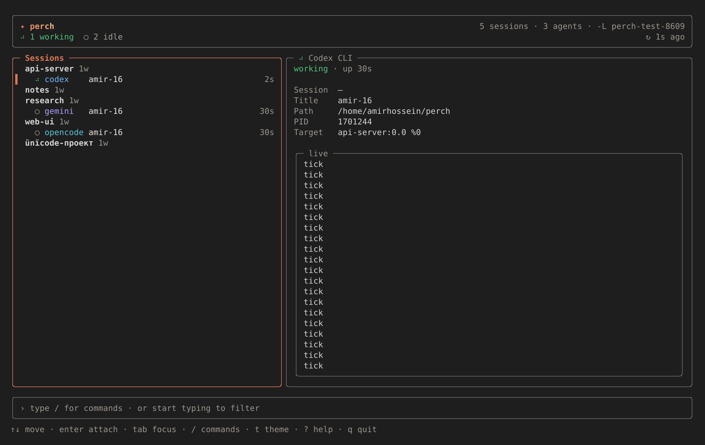
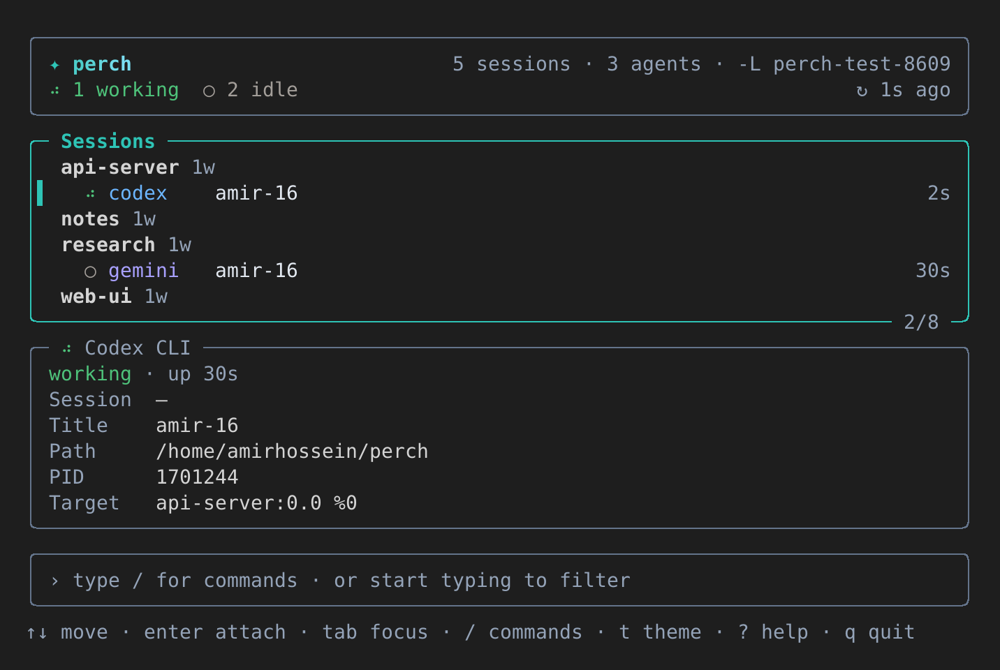
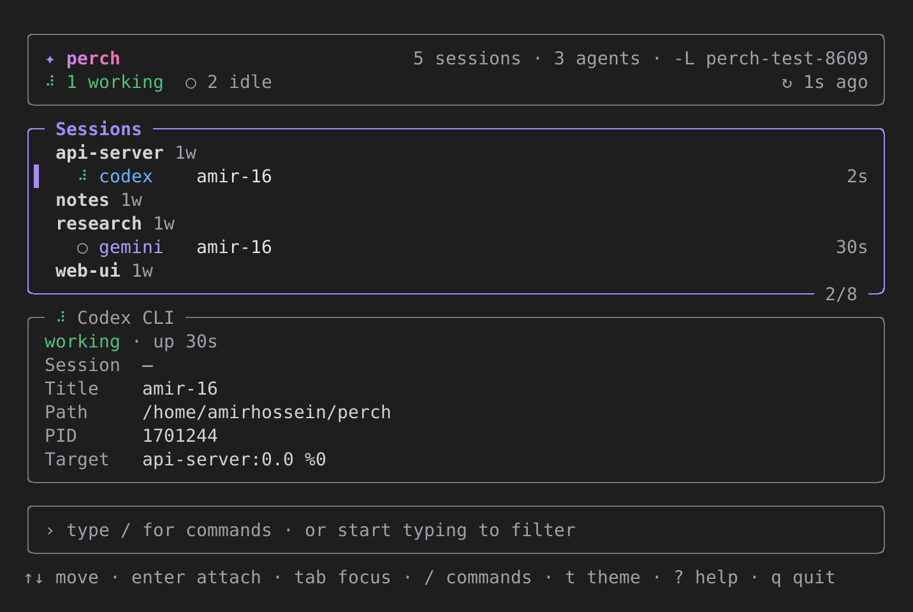
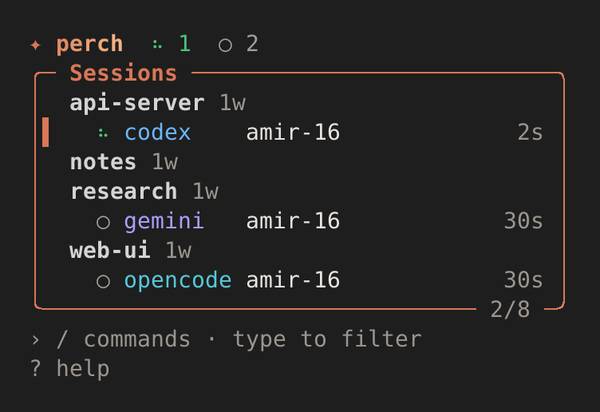
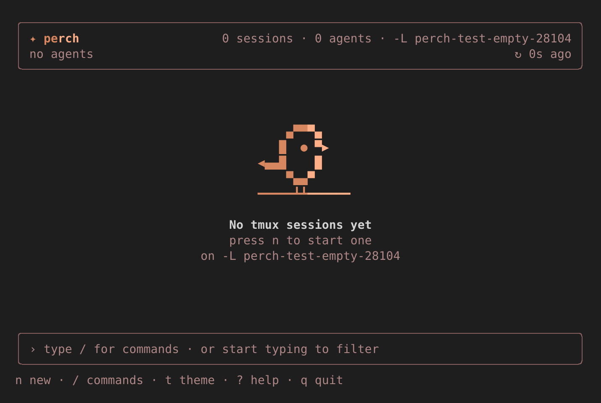

# perch



`perch` lists every tmux session, window and pane. For each pane running
one of five coding agents, it shows the agent's **status, session id, title and working path**,
refreshed live:

- Claude Code
- OpenAI Codex CLI
- Hermes Agent
- Google Gemini CLI
- OpenCode

You can use it as a full-screen TUI or as plain commands that print tables or JSON.

- It fits any terminal from a 40×12 phone screen (Termux, Blink, SSH) to 200+ columns.
- It works with or without colour and Unicode, and needs no Nerd Font.
- Mouse and touch scrolling work where the terminal sends them.
- It is one static binary for Linux and macOS (amd64, arm64) and Linux armv7.

## Install

```sh
curl -fsSL https://raw.githubusercontent.com/amirhosseinbanaei/perch/main/install.sh | sh
```

The script picks the build for your OS and CPU and checks it against `checksums.txt`. It
installs `perch`. Running it again upgrades in place, and it never calls `sudo` itself.

| Variable            | Effect                                                                                                   |
| ------------------- | -------------------------------------------------------------------------------------------------------- |
| `PERCH_VERSION`     | Install this version (`0.2.0` or `v0.2.0`) instead of the latest release                                 |
| `PERCH_INSTALL_DIR` | Install here. Default: `$PREFIX/bin` on Termux, else `/usr/local/bin` when writable, else `~/.local/bin` |
| `PERCH_BASE_URL`    | Download from this base instead of GitHub Releases (files under `download/v<version>/`)                  |

To install system-wide when `/usr/local/bin` is not writable:
`curl -fsSL …/install.sh | sudo sh`.

tmux itself is needed:

| System        | Command               |
| ------------- | --------------------- |
| Debian/Ubuntu | `apt install tmux`    |
| Fedora        | `dnf install tmux`    |
| Arch          | `pacman -S tmux`      |
| Alpine        | `apk add tmux`        |
| macOS         | `brew install tmux`   |
| Termux        | `pkg install tmux`    |

## The TUI

Run `perch` with no arguments in a terminal. It is built from rounded panels: a header with
the status counts, **Sessions**, **Detail**, and a command bar. The layout follows the
terminal's width:

| Width         | Layout                                                                     |
| ------------- | -------------------------------------------------------------------------- |
| under 60      | Sessions only. Enter opens Detail full-screen, Esc goes back               |
| 60–99         | Sessions, with Detail below it                                             |
| 100 and wider | Sessions on the left (40%), Detail on the right                            |

Under 16 rows the header and the command bar shrink to one line each and the live preview is
hidden. Tab and Shift-Tab move focus between Sessions and Detail; the focused panel's border is
in the accent colour. Arrow keys act on the focused panel: in Detail they scroll the preview.

| 80×24, teal | 80×24, violet | 40×12, coral |
| ----------- | ------------- | ------------ |
|  |  |  |

Each session shows its name, the window count, and an `att` pill when a client is attached.
Under it are its agent panes: a status symbol, the agent, the title and the age of the last
activity. A waiting agent says `needs you`. A working agent's symbol spins.

| Status   | Symbol      | ASCII |
| -------- | ----------- | ----- |
| working  | `●` (spins) | `*`   |
| waiting  | `◆`         | `!`   |
| idle     | `○`         | `o`   |
| exited   | `✕`         | `x`   |
| starting | `…`         | `~`   |

`waiting` means the agent needs a person: a permission or trust dialog, or a question. When an
agent turns waiting, its row pulses for 3 s and a toast says so (`--bell` also rings the
terminal bell). An agent that ends while its pane stays open is shown as `exited` for 60 s.

Detail shows the status and uptime, the full session id, title, path, pid and target, and under
them a live panel with the pane's last lines. `/source` (or `--verbose`) adds where each field
came from.

### Keys

| Key            | Action                                                                     |
| -------------- | -------------------------------------------------------------------------- |
| `↑` `↓` / `j` `k` | Move, or scroll the preview when Detail has focus (also PgUp/PgDn, Home, End/`G`) |
| `tab`          | Focus Sessions or Detail                                                   |
| `enter`        | Attach to the session; in the narrow layout, open Detail                   |
| `a`            | Attach                                                                     |
| `n`            | New session: name, directory, and an agent picked from those on PATH       |
| `r`            | Rename the session                                                         |
| `x`            | Kill the session. It asks first, and the default is No                     |
| `s`            | Send text to the pane. `tab` toggles "and press Enter"                     |
| `p`            | Toggle the live preview                                                    |
| `g`            | Show only sessions with agents                                             |
| `l`            | The log of changes seen in this run                                        |
| `t`            | Next theme: coral → teal → violet. It is saved                             |
| `y`            | Copy the session id with OSC 52, which also works over SSH                 |
| `R`            | Refresh now                                                                |
| `?`            | Help                                                                       |
| `/` or `:`     | The command bar (below)                                                    |
| any other key  | Starts a filter in the command bar                                         |
| `q` / `ctrl+c` | Quit                                                                       |

No key needs Alt or a function key. The mouse wheel scrolls the panel under it, a click
focuses a panel and selects a row, and a click on the selected row opens it.

### The command bar

`/` (or `:`) opens the bar with a popup of commands; Tab completes, Up and Down choose, Enter
runs, Esc leaves. Without an argument a command acts on the selection.

```text
/attach [target]   /new <name> [-c dir] [--agent id]   /rename <new name>   /kill [name]
/send <text>       /filter <text>   /agents   /theme [coral|teal|violet]   /preview
/source            /log   /refresh   /help   /quit
```

`/kill` only opens the confirm; typing it never kills. `/new`, `/rename` and `/send` with no
argument open their forms. Errors show under the bar.

**Filtering changed:** `/` used to start the filter. Now typing any key that is not a shortcut
starts a filter and updates the list as you type; Enter keeps it and Esc clears it. To filter
by a word that starts with a shortcut letter, use `/filter <text>`, or type `/` and the word:
a `/word` that names no command filters by it.

### Themes

Three themes, each with a dark and a light variant picked from the terminal's background:
**coral** (the default), **teal** and **violet**. The theme comes from `--theme`, then
`PERCH_THEME`, then the `theme` key in `$XDG_CONFIG_HOME/perch/config.json` (else
`~/.config/perch/config.json`). `t` and `/theme` switch it and save it there; other keys in the
file are kept. A bad file or name is reported in the footer and the default is used.

Without colour (`--no-color`, `NO_COLOR`) the TUI uses bold and dim only, and the status
symbols. `--no-anim` (or `PERCH_NO_ANIM=1`) stops the spinner and the pulse; animation is also
off without colour.

When there are no sessions:



Attaching outside tmux suspends the TUI. Detaching (`ctrl-b d`) brings it back. Inside tmux, it
switches your client to the session and keeps the TUI running.

## Commands

```text
perch                     the TUI on a terminal; otherwise the same as `ls`
perch ls [--json]         sessions: name, windows, attached, created, activity, agents
perch agents [--json] [--agent ID] [--status S]
                                 one row per agent pane: TARGET AGENT STATUS SESSION-ID TITLE PATH AGE
perch log [--follow] [--interval 2s] [--json] [--file PATH]
                                 a status report; --follow prints one line per change
                                 (JSON Lines with --json); --file appends to PATH as well
perch new NAME [-c DIR] [--agent ID | -- CMD...]
perch attach TARGET
perch rename OLD NEW
perch kill NAME [--yes]   asks on a terminal; refuses without --yes otherwise
perch send TARGET TEXT [--enter]
perch peek TARGET [--lines N]
perch doctor              tmux, socket, agents on PATH, state dirs, UTF-8, colour
perch version
perch completion bash|zsh|fish|powershell
```

Global flags:

| Flag          | Effect                                         |
| ------------- | ---------------------------------------------- |
| `-L SOCKET`   | Same as tmux's `-L`                            |
| `-S PATH`     | Same as tmux's `-S`                            |
| `--no-color`  | No colour. `NO_COLOR` is honoured too           |
| `--ascii`     | ASCII only. Automatic when the locale is not UTF-8 |
| `--verbose`   | Adds PID, CONF, SOURCE and NOTE columns; in the TUI, shows Source |

TUI-only flags: `--theme coral|teal|violet`, `--no-anim`, `--bell`, `--interval 2s`.

A TARGET is a session name, `session:window.pane`, or a pane id `%N`. A target that matches more
than one thing is rejected.

| Exit code | Meaning          |
| --------- | ---------------- |
| 0         | ok               |
| 1         | error            |
| 2         | bad usage        |
| 3         | target not found |

The `--json` output of `ls` is the same snapshot the TUI draws.

## How agents are found

Each refresh reads tmux twice (`list-sessions` and `list-panes -a`) and runs `ps` once. For each
pane it walks the processes under the pane, nearest first. A process counts only by the start of
its arguments: the executable's name, or the script an interpreter runs. A `grep claude` or an
`nvim claude.md` never counts. Per-agent details and their sources are in [AGENTS.md](AGENTS.md).

## Publishing a release

To publish a new version:

1. Merge your branch into `main` and `git push origin main`.
2. `git tag v<version> && git push origin v<version>`, for example `v0.2.0`.

The `release` workflow then runs `scripts/release.sh` and attaches the archives and
`checksums.txt` to the GitHub Release. From then on, the one-line installer works.

To build the archives locally: `scripts/release.sh 0.2.0` writes them to `dist/`.

## License

MIT, © amir hossein banaei.
